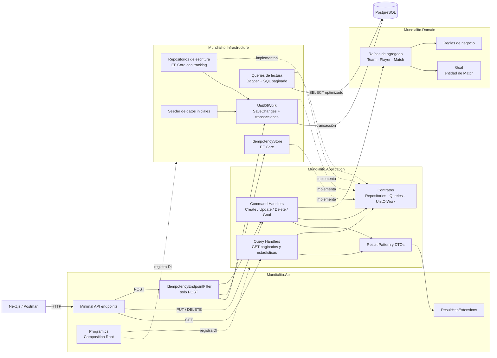

# Arquitectura de Mundialito

La solución aplica Clean Architecture y CQRS. Las escrituras pasan por EF Core y
un único `IUnitOfWork`; las lecturas se ejecutan exclusivamente con Dapper y
devuelven DTOs paginados.

## Flujo de escritura

1. `POST`, `PUT` o `DELETE` llega al endpoint de API.
2. En los `POST`, el filtro exige `Idempotency-Key`, calcula el hash del cuerpo y
   abre la transacción que incluye el recurso y la respuesta idempotente.
3. El Command Handler valida las reglas y modifica los agregados mediante el
   repositorio de `Team`, `Player` o `Match`.
4. El handler confirma explícitamente mediante `IUnitOfWork`.
5. `UnitOfWork` es el único componente que llama `SaveChangesAsync()` y controla
   commit o rollback en PostgreSQL.

`Goal` no tiene repositorio propio: se registra mediante `Match.AddGoal()` y se
persiste como parte del agregado `Match`.

## Flujo de lectura

1. Un `GET` llega al endpoint y crea la query correspondiente.
2. El Query Handler normaliza paginación, ordenamiento y filtros.
3. La implementación de Infrastructure ejecuta SQL parametrizado con Dapper.
4. PostgreSQL realiza filtros, conteo, ordenamiento y paginación; no se carga la
   tabla completa en memoria.
5. La API devuelve DTOs o un resultado paginado.

## Responsabilidad por proyecto

| Proyecto | Responsabilidad |
| --- | --- |
| `Mundialito.Domain` | Entidades, agregados y reglas del negocio. |
| `Mundialito.Application` | Casos de uso, contratos, DTOs, CQRS y Result Pattern. |
| `Mundialito.Infrastructure` | EF Core, Dapper, PostgreSQL, repositorios, Unit of Work, idempotencia y seed. |
| `Mundialito.Api` | Transporte HTTP, validación de headers, DI y traducción de resultados a HTTP. |
| `src/web` | Cliente Next.js que consume la API por HTTP. |

